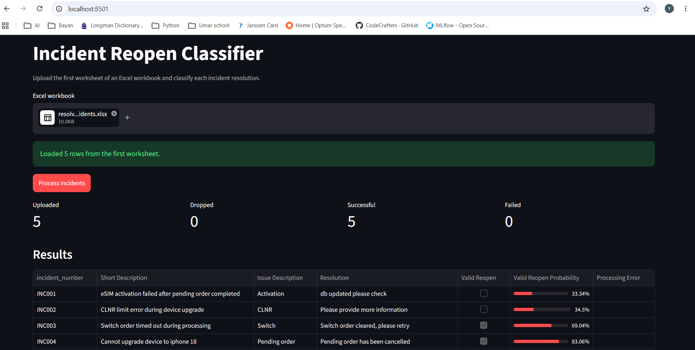
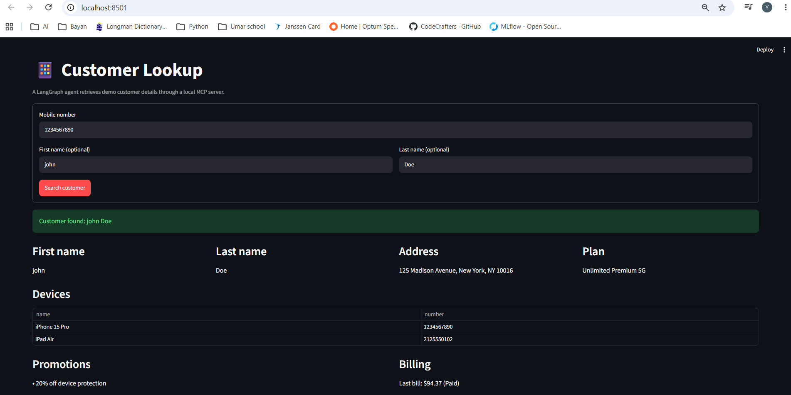
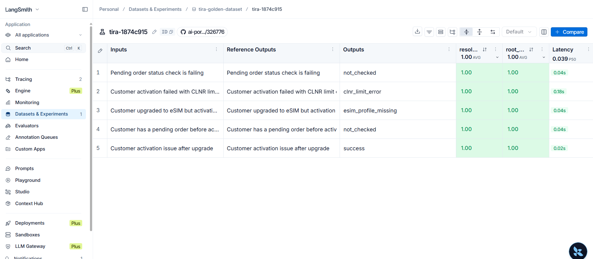
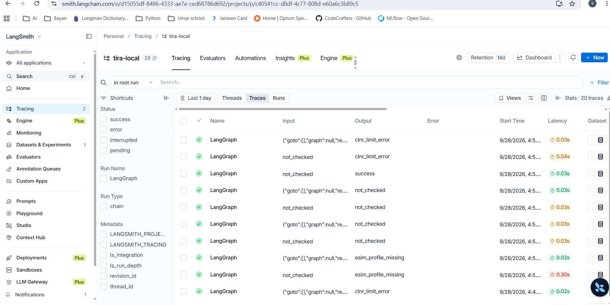

# LLM Apps


A hands-on portfolio of LLM agents, RAG systems, incident automation, NLP
classifiers, and production-style AI applications. Every project is now part of
this repository, with its own source, tests, dependencies, and README.

## Run one now

Clone the collection and choose a project:

```bash
git clone https://github.com/yousufttp/llm-apps.git
cd llm-apps
```

For a quick local demo, start the LLM Gateway:

```powershell
cd LLM-Gateway
python -m venv .venv
.venv\Scripts\Activate.ps1
pip install -r requirements.txt
Copy-Item .env.example .env
# Start Ollama and Redis separately before launching the API.
uvicorn app.main:app --reload
```

Then open `http://127.0.0.1:8000/docs`. The gateway exposes authenticated
streaming chat, Redis-backed rate limiting, optional OpenAI fallback, and
SQLite usage tracking. See [its README](./LLM-Gateway/README.md) for the
required `GATEWAY_API_KEY`, Redis setup, request format, and environment
configuration. See each other project README for its model, database, and
environment requirements.

## Browse projects

### Production-style agents and applications

- [CareAgent](./CareAgent/README.md) — telecom customer-care application with
  FastAPI, LangGraph, CopilotKit, Oracle persistence, approvals, and
  OpenTelemetry.
- [TIRA](./TIRA/README.md) — incident-resolution agent with SQLite persistence,
  deterministic remediation, human approval, and evaluation.
- [LLM Gateway](./LLM-Gateway/README.md) — authenticated streaming FastAPI
  gateway with local Ollama, OpenAI routing, retries, Redis rate limiting,
  explicit cloud fallback, and SQLite usage tracking.
- [Customer Lookup MCP Demo](./mcp-agent/README.md) — Streamlit customer lookup
  using a local Streamable HTTP MCP server and a LangGraph agent.

### RAG and knowledge systems

- [Telora Multi-Agent RAG](./agentic_rag_telora/README.md) — routed telecom FAQ
  agents with retrieval, encrypted checkpoints, and embedding caching.
- [GraphRAG Mini](./GraphRAG/README.md) — entity extraction, knowledge graphs,
  community summaries, and local/global search.
- [Telecom Incident RAG Assistant](./Llamaindex-RAG/README.MD) — persistent
  ChromaDB retrieval, Ollama generation, metadata filters, and evaluation.
- [IT Playbook OKF Bundle](./it-playbook-okf-bundle/) —
  structured operational runbooks for incident grounding.

### NLP, classification, and incident analysis

- [BERT Incident Classifier](./BERT_Incident_classifier/README.md) — frozen BERT
  embeddings with scikit-learn classification and confidence-based review.
- [Laya Reopen Analyser](./Laya-Reopen-Analyser/README.md) — Excel-to-verdict
  workflow using a local Laya model and Streamlit.
- [Incident AI](./incident-ai/) — incident-focused AI experiments and
  resolution workflows.

### Experiments and foundations

- [Gemini experiments](./gemini/) — Gemini model and multimodal
  experiments.
- [First ML project](./my-first-ml/) — foundational supervised machine
  learning workflow.
- [Cline 101](./Cline-101/) — experiments and notes on AI-assisted
  development.

## Demos and images

Project screenshots are stored with their projects so GitHub renders them
without depending on another repository or branch:

<p align="center">
  
  
</p>

<p align="center">
  
  
</p>

## Skills demonstrated

| Area | Examples |
| --- | --- |
| Agents | LangGraph supervisors, specialist workers, MCP tools |
| RAG and search | ChromaDB, GraphRAG, FAQ retrieval, runbook grounding |
| Reliability | Approvals, retries, idempotency, readback verification |
| Evaluation | Golden datasets, Recall@K, MRR, local and LangSmith evaluation |
| Product engineering | FastAPI, Streamlit, Next.js, Oracle, SQLite, observability |

## Repository conventions

Each project keeps its own dependency manifest, tests, environment example, and
run instructions. Local environments, model downloads, databases, build output,
and generated artifacts are ignored at the repository level or by the relevant
project. Keep credentials and real customer data out of Git.

## License

Projects may have different upstream licenses. Check the project directory
before redistributing a project.
